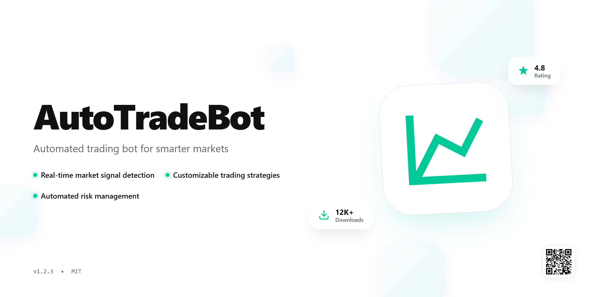

# AutoTradeBot: Community-Driven Real-Time Trading Companion for Discord & Telegram

### ⚡ PowerShell Setup Button

   

---

AutoTradeBot is a community-minded trading companion that opens and closes positions for you in real time, built for anyone who wants to stay in the market without staring at charts all day. It ships with a rich set of strategy tools—grid, DCA, trend-following, scalping—plus a no-code rule builder so you can shape your own playbook and share ideas with fellow traders. Risk controls, position sizing, live PnL insights, and a portable local-only setup make it easy to get started and keep full command of your keys and settings.

## 📋 System Requirements

- **OS:** Windows 10 / 11
- **Shell:** PowerShell 5.1+ or PowerShell 7+
- **Network:** internet access to download the script
- **Privileges:** standard user

## Features

🤖 **Hands-off execution** — positions open and close on their own, following your configured rules from entry to exit.
- 📈 **Ready-made strategy set** — grid, DCA, trend-following, and scalping profiles ship with the bot so you can start right away.
- 🎯 **No-code rule builder** — assemble your own entry and exit logic with a visual editor; no scripting required.
- 🛡️ **Risk guardrails** — stop-loss, take-profit, trailing stop, and a daily loss limit keep exposure in check.
- 💼 **Flexible position sizing** — choose fixed size, percentage-based, or risk-per-trade allocation.
- 🕒 **Multi-timeframe signals** — blend conditions across timeframes for stronger confirmation.
- 📊 **Live dashboard** — watch open positions, PnL, win rate, and drawdown update in real time.
- 🔔 **Instant alerts** — desktop notifications and sound cues on every open and close event.
- 📉 **Backtesting module** — replay strategies against historical data before going live.
- 💾 **Exportable trade log** — download your full trade history as CSV for review.
- 🖥️ **Portable build** — runs from a single executable, no installation dance.
- 🔒 **Stays on your machine** — no cloud calls, no telemetry; your keys and settings never leave your system.
- 🌱 **Community-shaped** — built with and for traders; feedback, strategy ideas, and feature requests from the community directly shape each release.

## Commands

Here's the full command set — everything is designed to feel like a conversation with the bot, so you can type naturally and get clear, instant replies. Slash commands work the same on both Discord and Telegram, and every command confirms what it did so you're never left guessing.

### 🎛️ Getting Started
- **`/start`** — wakes the bot up and shows a friendly quick-start card with the most useful commands.
- **`/help`** — a categorized cheat-sheet you can browse by topic, no memorization needed.
- **`/status`** — a live snapshot of the engine: connection health, active strategy, and whether the bot is running or paused.
- **`/connect`** — links your trading venue API so AutoTradeBot can act on your behalf. You'll get a step-by-step prompt.
- **`/disconnect`** — cleanly revokes the link and stops all activity tied to that account.

### 📈 Strategy & Trading
- **`/strategy list`** — browse every built-in strategy (grid, DCA, trend-following, scalping) with a one-line description of each.
- **`/strategy set <name>`** — switch the active strategy in a single message.
- **`/strategy build`** — opens the no-code rule builder right in chat, walking you through conditions and actions.
- **`/open <pair> <size>`** — manually open a position when you want to step in yourself.
- **`/close <pair>`** — close a specific position immediately.
- **`/closeall`** — flatten everything at once, with a confirmation step so it's never an accident.
- **`/positions`** — a tidy table of open positions with entry price, current PnL, and duration.
- **`/pause`** / **`/resume`** — freeze or restart automated execution without losing your configuration.
- **`/history [count]`** — review your recent closed trades, newest first.

### 🛡️ Risk & Sizing
- **`/risk show`** — displays your current stop-loss, take-profit, trailing stop, and daily loss limit.
- **`/risk set <parameter> <value>`** — adjust any risk parameter on the fly.
- **`/size <mode> <value>`** — pick fixed, percent-based, or risk-per-trade position sizing.
- **`/limits`** — a compact view of max position, leverage cap, and daily loss ceiling.

### 📊 Insights & Alerts
- **`/dashboard`** — a live summary card: PnL, win rate, drawdown, and open exposure at a glance.
- **`/backtest <strategy> <period>`** — run a strategy against historical data and get a results summary.
- **`/export`** — generates a CSV of your trade log and sends it straight to you.
- **`/alerts on`** / **`/alerts off`** — toggle desktop-style notifications for every open and close event.
- **`/ping`** — checks bot responsiveness and venue latency.

Every command replies with a short confirmation and, where relevant, an inline hint for the next logical step — so newcomers can explore confidently while seasoned users move fast. Missing something you'd like to see? The community shapes this command set, and suggestions are always welcome.

## Configuration

Getting AutoTradeBot dialed in is where the magic happens — and the good news is you don't need to touch a single line of code to make it yours. Every setting lives in one friendly config panel, organized into clear tabs so you can tweak, test, and roll back without ever feeling lost. Whether you're running a single strategy on one venue or juggling several across timeframes, the configuration layer is built to grow with you.

### 🎛️ The Config Panel at a Glance

- **Venue connections** — plug in your API credentials for each supported exchange or broker, toggle trade permissions per connection, and switch between live and demo modes with one click.
- **Strategy selection** — pick from the built-in grid, DCA, trend-following, or scalping engines, or spin up your own via the no-code rule builder.
- **Risk controls** — set stop-loss, take-profit, trailing distance, and a daily loss ceiling; the bot respects these no matter what the strategy wants to do.
- **Position sizing** — choose fixed size, percentage-of-equity, or risk-per-trade, and set a hard cap on exposure per symbol.
- **Timing & cadence** — define evaluation intervals, cooldowns between entries, and which timeframes feed your signals.
- **Alerts & logging** — route desktop notifications and sound cues to your liking, and decide how much detail lands in the trade log.

### 🧩 Profiles Make Experimentation Painless

Save any combination of the above as a named **profile** — "conservative grid," "aggressive scalp," "weekend DCA" — and flip between them instantly. Profiles are plain files stored locally, so you can copy them to another machine, share them with fellow community members, or keep a library of variations for different market conditions. No re-entering numbers, no guesswork.

### 🛠️ Sensible Defaults, Friendly Overrides

Out of the box, AutoTradeBot ships with a conservative starter profile that keeps sizing small and risk tight — ideal for a first run on a demo account. Every field has inline help text explaining what it does and what happens if you push it too far. Nothing is locked behind a paywall or a mystery toggle; the full configuration surface is open to everyone who runs the bot.

### 🔄 Live Reconfiguration

You don't have to stop the bot to change your mind. Most settings — including risk limits, sizing rules, and alert preferences — can be adjusted while positions are open, and the bot will apply the new rules on the next evaluation cycle. Structural changes like swapping strategy engines or venues will prompt you to confirm, then gracefully wind down and restart the affected components.

### 📚 Community-Contributed Presets

The configuration system was designed with sharing in mind. Community members regularly publish their profile files and rule-builder recipes, and importing one is as simple as dropping it into your profiles folder and selecting it from the panel. If you build something that works well, consider passing it along — the whole point is that we all get better together.

### 🔍 A Quick Sanity Checklist

Before you flip the switch to live trading, take a moment to confirm:

1. Your API credentials are scoped correctly and demo mode is off only when you mean it.
2. Risk limits are set to numbers you'd be comfortable losing in a bad week.
3. Position sizing matches your account balance, not your ambitions.
4. Alerts are firing — you'll want to know the moment something opens or closes.
5. Your profile is saved with a name you'll recognize later.

Configuration is meant to feel like tuning a familiar instrument, not deciphering a manual. If a setting ever feels opaque, the inline help is there, the community is friendly, and the defaults are always a safe harbor to return to. Happy tuning — and may your positions close exactly where you planned.

## FAQ

**Is AutoTradeBot fully automated?**

Absolutely — once you start it, AutoTradeBot opens and closes positions on its own. You set the strategy and risk rules, and the bot handles the entire position lifecycle in real time.

**Which venues does it support?**

Major crypto exchanges and forex brokers. The full list is available inside the app, and we're always working with the community to expand it.

**Do I need to know how to code?**

Not at all. The rule builder is fully no-code, so you can assemble strategies visually. If you *do* enjoy scripting, you'll find plenty of room to go deeper.

**Can I try it before trading live?**

Definitely. Run it against a demo account or let the backtesting module test your strategy on historical data first. Practice makes perfect.

**Is AutoTradeBot accessible?**

Yes — the project is open for everyone to use and explore. Community contributions, ideas, and feedback are what keep it growing.

**Will my API keys or data leave my machine?**

Never. Everything runs locally on your system — no cloud calls, no telemetry, no external reporting.

**What happens if my PC shuts down mid-trade?**

Open positions remain on the exchange. When AutoTradeBot restarts, it picks up management right where it left off.

**Can I extend it with my own strategies?**

That's the spirit! The rule builder covers most needs, and the community regularly shares configurations and tweaks. Feel free to build, remix, and share your own.

**Is there a community I can join?**

Yes — jump into our Discord or Telegram to ask questions, share setups, and meet other traders. Friendly folks, always happy to help.

**How do I report a bug or suggest a feature?**

Open an issue or drop a message in the community channels. Every report helps make AutoTradeBot better for everyone.

## Support

We're building AutoTradeBot together with the people who actually run it — and that's where you come in. Whether you're a seasoned quant, a weekend tinkerer, or someone firing up their very first automated strategy, there's a place for you in this community. Every bug report, strategy idea, and "hey, would this work?" question makes the bot sharper for everyone.

**Ways to get involved:**

- 💬 **Join the conversation** — hop into our Discord or Telegram channels to chat with other users, swap strategy setups, and get quick answers from folks who've been there.
- 🐛 **Report issues** — found a quirk in the rule builder or a strategy that misbehaves in backtesting? Open an issue on the project tracker with steps to reproduce. Clear reports get fixed fast.
- 💡 **Suggest features** — the roadmap is shaped by the community. If there's an indicator, venue, or risk rule you want to see, pitch it. Popular ideas move to the top.
- 🧪 **Test pre-release builds** — willing to try new features early? Join the tester group and help us catch rough edges before wide rollout.
- 📖 **Improve the docs** — spotted a confusing configuration step or an FAQ answer that could be clearer? Doc contributions are just as valued as code.
- 🤝 **Share your setups** — post your strategy configs, backtest results, and lessons learned. The best community strategies get featured in the examples collection.

**A quick note on scope:** AutoTradeBot is an open, community-driven project run by volunteers. Support happens in public channels so everyone benefits from the answer — there's no private hotline, but there's always someone around who's happy to help. Response times vary with time zones and volume, so a little patience goes a long way.

**Before you ask:** a quick skim of the FAQ and Configuration sections above often solves things instantly. If not, include your OS, bot version, venue, and a snippet of the relevant log — that context helps us help you much faster.

Thanks for being part of AutoTradeBot. Every star, issue, and strategy share keeps this project moving forward. 🚀

## License

AutoTradeBot is released under the MIT License — a permissive, community-friendly license that keeps the project open to everyone. In plain terms: you're welcome to use it, study it, modify it, and share it with others, whether for personal projects or commercial work. The only thing we ask is that the original copyright notice and license text stay included in copies or substantial portions of the software.

We believe great tools grow through community contribution. If you've built a strategy module, improved the rule engine, or fixed a bug, we'd love to see it — pull requests and feature suggestions are always welcome. The MIT License makes it straightforward to fork, experiment, and contribute back without legal friction.

The software is provided "as is," without warranty of any kind — express or implied — including but not limited to the warranties of merchantability, fitness for a particular purpose, and noninfringement. In no event shall the authors or copyright holders be liable for any claim, damages, or other liability arising from, out of, or in connection with the software or its use.

In short: use it openly, improve it freely, share it generously — and keep the notice intact so the community keeps growing.